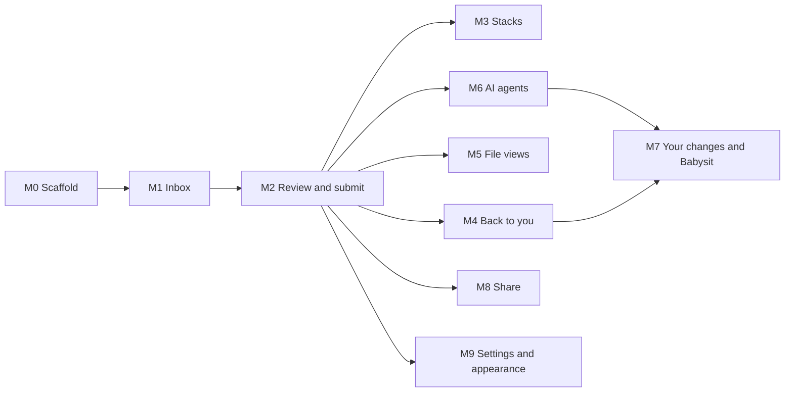

# Roadmap

This roadmap orders the work from the scaffold to the product in [PRODUCT.md](PRODUCT.md). It is for contributors who pick the next milestone. Each milestone lists the Figma frames it builds, the engine commands it adds, and the check that ends it.

Design source: the [PR Craft Figma file](https://www.figma.com/design/wcaX5xmPm328weS8YeAR0Y/PR-Craft?node-id=0-1), page "Desktop App". Frame numbers below (`01`, `33`) are the number prefix of each frame name. Sections `1 · Set up` to `7 · Your own changes` are user journeys. Sections 8 to 14 hold their states, panes, tooltips, Activity, the remaining settings and more flows. Section 15 holds dark versions of existing screens, section 16 holds the whole stack, the author side and more file types, section 17 holds merging, threads and navigation, section 18 holds authoring, first run, About and privacy, section 19 holds hover, keyboard focus, right-click menus and empty states (rules on Design System → `DS · Interaction states`), and section 20 holds more context menus and dark versions of the newer surfaces. Every frame from `01` to `118` is assigned to one entry below.

## Order

The diff is the work (product principle 1), so the review loop ships before AI. Each milestone needs the one before it, except where the graph shows a branch.

## Long-term horizons

[docs/designs/long-term-roadmap.md](docs/designs/long-term-roadmap.md) takes the built milestones to a team of 3 to 8 engineers who each clear their daily queue without the forge web UI. It runs in five horizons, each closed by an exit line: H1 Prove (live writes, diagnostics, additive-only data), H2 Ship (.app, Releases, update check, quota safety), H3 Trial (5 days, banners, tally), H4 Cap (AI ceiling, worktree cleanup, pruning), H5 Extras (Visualize, Babysit, self-update). Nothing in it asks storytold for a change.

## Rules every milestone keeps

- Every user action is an engine command in `crates/engine` first, then a panel and a `pr-craft-cli` call (AGENTS.md rule 14). A milestone is not done while the CLI cannot do what the panel does.
- Each forge keeps its own words. GitHub says "pull request", GitLab says "merge request" and "pipeline".
- Every shown action has a visible shortcut (product principle 3), and keyboard navigation moves egui focus (rule 21).
- Nothing the reviewer wrote is lost. Drafts persist on this Mac before any post.
- Colours and sizes come from `crates/ui-egui/src/theme.rs` tokens that match [DESIGN.md](DESIGN.md).

## M0 Scaffold (done)

The window and `pr-craft-cli forge.status` report the `gh` and `glab` login state.

## M1 Unified inbox, read only

Lists open pull and merge requests waiting on the user, from both forges, in one list.

- Frames: `01` Inbox, `15` Scrolled list, `40` Sidebar sections folded, `31` First sync, `32` All clear, `03` Settings Accounts, `36` Connection problems.
- Commands: `inbox.list` (queries every forge live; a persisted sync waits for offline work in M2), `forge.status`.
- Failure: an expired login or a missing CLI pauses that forge's sync and shows the exact fix command (`36`).
- Done when `pr-craft-cli inbox.list` returns the same items the inbox shows, for a GitHub and a GitLab account.
- After M1: `39` Sidebar hidden, `83` Filtered to one repository, `53` Tooltip on the waiting count, `93` Search results (`inbox.search`: titles, branches, comments, local drafts, merged and closed), `106` Search finds nothing, `98` First run (checks `gh`, `glab` and the AI engine, shows the fix command, lets the user start with one forge), `102` Hover and keyboard focus in the inbox (hover reveals Open ↵ and On GitHub ⌥↵), `104` Right-click a change (Open review, Open on GitHub, Copy link). They extend the M1 inbox and do not change its done check.
- Hosts, built and reviewed (CI green): each forge reads every host its CLI is signed in to, in parallel, so self-hosted GitLab and GitHub Enterprise sit beside gitlab.com and github.com. Every `gh` and `glab` call is pinned to its change's host (`GH_HOST`, `GITLAB_HOST`). Filters and layouts are stored per host, and reviews on a non-default host are saved under `reviews/<forge>@<host>/`. GitLab reads page by page, Back to you up to three pages per host, and a full page sets the truncated flag. Sources shows one line per host when there is more than one or when a host failed. A host that failed stays named in rose. A host the CLI knows but is not signed in to is listed as not read and does not count. "Nothing waits on you" shows only when every signed-in host answered (`SourceState::incomplete`). Run live and read-only on github.com and one self-hosted GitLab. Not run: a real GitHub Enterprise server, or two GitLab hosts at once.

## M2 Diff review and batch submit

The core loop. Read a change, comment on lines, submit one review.

- Frames: `02` Review, `23` Files as tree, `24` Files as list, `10` Filter and viewed, `46` Filter matches nothing, `14` Scrolled diff, `04` Select lines, `05` Write comment, `33` Loading a large change, `34` Errors, `38` Panes folded, `52` Tooltip on a folded file, `71` Minimum window 1100×720, `90` Resolve thread, outdated threads and more context, `91` Split view and diff options, `95` Pick commits to review, `92` Command palette `⌘K`, `103` Hover a line and right-click a selection, `105` Right-click a folder in the file tree, `108` Every file viewed, `107` Local drafts with none on this Mac, `111` Right-click a thread and a resolved thread; cut: `112` Right-click a file tab (the app has no file tabs; the tab bar drawn in `02` and its clones is not built).
- Commands, built: `review.open` (returns the change and its files), `review.local` (the review as saved on this Mac), `review.mark_viewed`, `review.filter`, `draft.add`, `draft.edit`, `draft.delete`, `review.compose` (verdict and general comment), `review.submit`, `review.markdown` (Copy as Markdown).
- Commands, built for frames `90`, `91`, `92`, `95`: `review.set_layout` (unified or split, hide whitespace, word highlight, wrap), `review.expand`, `review.commits`, `review.range`, `thread.list`, `thread.reply`, `thread.resolve`, `palette.query`.
- Keys: `L` split, `O` diff options, `W` hide whitespace, `⇧W` word highlight, `⌥Z` wrap; `⇧K`, `⇧J`, `⌥E` expand context; `T` and `⇧T` step through threads, `⇧R` resolve, `⌥R` reply; `⇧C` pick commits, `,` and `.` step one commit; `⌘K` palette; `⌘1` to `⌘3` queues.
- Palette, a deliberate departure from the scope line below: it also lists actions that only the app can do. Every entry carries `runs`: `engine_command` or `gui_only`, and automation must not run a `gui_only` entry. Entries that would do nothing in the current state are hidden.
- Safety: `⇧R` resolves only a thread that was stepped to and is drawn on screen. `⌘↵` in a reply field sends that reply, never the review. A picked commit range flags its merge commits and offers "Leave out merge commits". Hide whitespace keeps changes in the spacing between tokens.
- Scope: keyboard moves between files, hunks and comments. Viewed files collapse and un-mark when they change. Include and exclude globs, saved per repository. Drafts stay local until `review.submit` posts them as one batch (`⌘↵`). Comments whose lines changed show as outdated. The palette lists only commands that exist in the engine.
- Failure: a rejected post keeps the drafts and the verdict, with Copy as Markdown.
- Cut from the first build, accepted: files grouped by folder in one list, with no tree or list toggle (`23`, `24`); no automatic pane folding below 1280 px (`38`); no suggested change; no offline queue, so drafts stay on this Mac and a failed Submit is retried by hand; a GitLab multi-line comment is pinned to its last line, and the UI says so.
- Status: built and reviewed, except the cuts above. The interaction-states pass is built and reviewed too (three review rounds, CI green): frames `103`, `105`, `107`, `108` here, `102`, `104`, `106` after M1, `109` in M4, `110` in M6 and `111` here, plus a Local drafts queue on `D` (`review.drafts_all`). That round cut frame `112` (no file tabs) and these menu actions, dropped in the final key table under `.egm`: Snooze, Done, Mark as unread, Ask Claude Code on a selection, Copy link to lines or thread, Copy branch name, repository Show only/Mute, Show the whole file, folder AI review, folder in VS Code, Reveal in Finder. Suggest a change shows disabled. The frames mirror that key table. Not verified live: hover and drag with a real pointer. Done check, partly run: with `gh` unreachable, a failed `review.submit` kept the draft, the verdict and the summary (`review.local` showed them). That stands in for a network-off run; a real network-off run has not been done. Threads, commits and expand were run live and read-only on three real GitHub PRs. Not run: a live post to a GitHub PR and a GitLab MR, and `thread.reply` and `thread.resolve`, which write to the forge. They need a sandbox PR and MR, the user's approval, and a `glab` login.
- Duplicate posts: a write to the forge that times out marks the review `post_unknown`. The next `review.submit` refuses until it is called with `confirm_unknown`, after the user has checked the change on the forge.
- Done when a review with line comments and a verdict posts to one GitHub PR and one GitLab MR, and a submit with the network off keeps every draft.
- After M2: `96` Open locally, built and reviewed. Commands: `checkout.status`, `checkout.worktree`, `checkout.here` (needs `confirm`), `open.editor` (VS Code, Xcode, Zed, Terminal). Keys `⌘O` and `⌘⇧O`, plus an Open action in the title bar. It does not change the M2 done check.
  - Safety: the worktree is detached at a private ref checked against the forge's head commit. Check out here refuses when there are uncommitted changes, when git says the switch would overwrite untracked or ignored files, during a merge or rebase, and with git older than 2.31. Git hooks are off for every git, `gh` and `glab` call (`core.hooksPath=/dev/null`), so no hook from the change runs. HEAD is checked after the switch, and every git, `gh` and `glab` call has a deadline.
  - Not run live: a real `gh pr checkout` or `glab mr checkout`, a fetch, or an editor launching. Tests use temporary repositories only.

## M3 Stacks

- Frames: `06` Review Stack, `74` Whole stack.
- Commands, built: `stack.list` (layers, bottom first), `stack.whole` (read-only diff from the bottom layer's base to the top layer's head, key `S` on the review screen; it refuses a stack whose top comes from a fork, and a listing truncated at one page). No `stack.open_layer`: a layer opens with `review.open`, and since its base is the layer below, the forge diff is already that layer alone.
- Scope: a change whose base is another open change's head joins its stack. `glab stack` stacks appear the same way. Each layer diffs against the layer below. The inbox groups a stack into one entry.
- Status: built. Done check, partly run: live, read-only `stack.list` found stacks on two GitHub repositories (two layers and six layers), and `stack.whole` gave 39 files where the top layer alone has 35. Not seen: a three-layer stack grouped into one inbox entry on screen, because none is in the user's queue. GitLab stacks are tested with fixtures only (`glab` is logged out on the dev Mac).
- Done when a three-layer stack shows as one inbox entry and each layer's diff excludes the layers below it.

## M4 Back to you and notifications

- Frames: `21` Inbox Back to you, `45` Back to you empty, `22` Since your review, `64` Hand off a review, `65` Back to you reminders, `07` Inbox Notifications, `109` Notifications with nothing new, `09` macOS Banners and Dock, `20` Menu bar tray, `08` Settings Notifications.
- Commands, built: `inbox.back_to_you`, `review.since_last` (marks the review `rewritten` when the reviewed commit was force-pushed away), `review.hand_off` (never run live, because it changes the reviewers on the forge), `notify.list`, `notify.pause` (toggle, or until a time), `notify.seen`.
- Keys: inbox queue Back to you `B`, Notifications `N` (pause `P`, mark seen `M`), Since your review `R`, hand-off sheet `H`.
- Scope: a reviewed change leaves the count while it is with the author and returns on new commits, replies, resolved threads, a re-request, a mention or a dismissed approval. Re-review shows only commits since the user's last review. Quiet hours and Focus hold notifications without dropping them.
- Blocked: the Dock badge and the menu-bar item (frames `09`, `20`). They need appkit bindings and the workspace forbids `unsafe`; they are out of the long-term roadmap. Banners are planned through `osascript display notification` in its H3; the 10:00 digest (`65`) is not planned yet. Until then the app says these are not available.
- Status: built except the blocked part. Done check not met: the banner half is blocked. Run: live, read-only `inbox.back_to_you` found one real change back with the user (new commits). Not run: the UI on screen, and GitLab outside fixtures (`glab` is logged out on the dev Mac).
- Done when a new commit on a reviewed change moves it back into the inbox and raises one banner.

## M5 File views

- Frames: `25` Markdown rendered, `69` Markdown source view, `26` Image compare, `78` Image difference mode, `79` SVG rendered and structure, `80` Notebook cells and outputs.
- Commands, built: `review.blob` (one side of a file; base64 for the CLI; the GitHub base is the merge-base, and a failed compare leaves the base unknown), `review.set_view` (remembered per extension), `review.views`.
- Scope: Markdown, images (2-up, Swipe, Onion skin, Difference), SVG and notebooks first. JSON, YAML, TOML, CSV and lockfiles have no frames yet. Design them before building. Comments anchor to source lines in every view.
- Built: Markdown rendered and source with block and word marks (`25`, `69`); images in 2-up, Swipe, Onion skin and Difference, with an ignore slider and the share of pixels changed (`26`, `78`); notebook cells and outputs, with changed outputs detected (`80`).
- Built for `79`: SVG Before and After on a checkerboard (a small icon grows up to 2.5×, 24 px shows at 60 px), and "What changed in the markup" from `pr_craft_core::svg`: elements matched by id, else by tag and place under their parent; one row per changed attribute or text, then added and removed elements (path data shows its first two segments and its point count). The view switcher offers Rendered, Structure (the rows alone) and Source; `⇧S` steps through them for an SVG. `C` comments on the picked row, else the first change, and posts on that element's source line; the draft remembers it was written on the rendered view (`on_rendered` on the draft and on `draft.add`). `E` edits the draft in focus. File headers of every file follow the frame: path and counts, then the views, Viewed and `V`.
- Cut, and said so in the UI: comments pinned to a point on an image or to a notebook cell, notebook image outputs. Markdown tables show as text. SVG rows past 500, and SVGs over 4 MB, 20,000 elements or 64 levels deep, are counted or refused with the reason.
- Rule 9 departure: the engine has its own small base64 encoder, because the `craft` facade at the pinned rev has no base64 crate and a new crates.io dependency needs a licence check (rule 26). It carries a `shortcut:` comment to move it to craft-libs.
- Status: built. Done check not run: posting a comment from a rendered view needs a sandbox PR and the user's approval. Run: `review.blob` returned the same bytes as `gh`'s raw output on a real PR. Not run: the views on screen, and GitLab outside fixtures.
- Done when a comment made in a rendered view posts on the matching source line.

## M6 AI engine, review agents and Activity

- Frames: `58` Settings AI engine, `101` What the AI engine sees, `12` New review agent, `28` Prompt slash commands, `66` Slash menu filtered, `30` Saved where it runs, `37` Repository agents, `51` Repository with no agents, `29` AI review the whole PR, `81` AI review sheet with no agents, `54` Tooltip on coverage, `13` Agents running, `35` Agent run with a failure, `50` Run tree and subagent detail, `56` Tooltip on a limit, `67` Spawn refused at the limit, `68` Subagent transcript, `49` AI review running in the background, `70` Tooltip on the task pill, `57` Activity popover, `61` Activity window `⌥⌘J`, `110` Activity with nothing running, `62` Stuck run notification, `82` Slash commands in a comment.
- Commands, built: `ai.engine.get`, `ai.engine.set`, `ai.read.set`, `agent.create`, `agent.update`, `agent.delete`, `agent.list`, `agent.scope_preview`, `ai.review.plan`, `ai.review.preview`, `ai.review.start` (`⌥⌘A`), `run.list`, `run.get`, `run.stop`, `run.kill`, `run.stop_all`, `draft.keep`, `draft.discard`. The contract is `.egm/m6-ai/contract.md`.
- Keys on an AI draft card: `A` keep, `⇧A` keep and edit, `X` discard.
- Scope: engines are Claude Code (`claude` CLI) and Z.ai GLM (key in the Keychain). Findings are AI drafts that post only after `draft.keep` and `review.submit` (product principle 4). Subagents are read-only. Spawn limits refuse and log. A run with no output for 5 minutes is flagged stuck (15 for long steps). Before any prompt is built, the `101` rules apply: the read scope, never-send patterns and secret redaction, overridable per repository.
- Safety, built: the engine gets the redacted diff and nothing else. `claude` runs with no tools, no MCP servers, and no user settings, CLAUDE.md, skills, plugins or hooks (`--tools ""`, `--strict-mcp-config`, `--restricted`, `--safe-mode`, in `crates/engine/src/runner.rs`). Redaction is best effort, and the UI says so. Never-send patterns are the guarantee. `ai.review.preview` shows the exact prompt, and a run starts only with that preview's hash or after a confirm step that names the engine and its cost.
- Built: every frame listed above except `82` (slash commands in a comment), which is cut.
- Not wired, and said so in the UI: Z.ai, skill text in prompts, engine-side subagents, triggers, and the macOS stuck-run notification (blocked with M4).
- Status: built. Done check not run live: running `claude` spends money and needs the user's approval. All tests ran against a fake engine.
- Done when an AI review covers every changed file (agents plus the general pass) and nothing posts without an explicit keep.

## M7 Your changes and Babysit

- Frames: `27` Inbox Your changes, `75` Back to you as the author, `97` Draft to ready for review, `11` Babysit, `44` Paused after an error, `70b` Tooltip on a disabled push, `94` CI job log, `88` Merge, `89` Merge conflict.
- Commands: `pr.ready`, `pr.set_reviewers`, `pr.set_labels`, `checks.log`, `checks.rerun`, `babysit.start`, `babysit.set_power`, `babysit.approve`, `babysit.stop`, `merge.start` (squash, merge commit or rebase), `merge.queue`, `merge.auto`, `conflict.draft_fix`.
- Scope: per owned change, each power (fix failing pipelines, draft replies, rebase) is off or ask first. The AI engine returns a fix as a patch; the app applies it in a local checkout and shows it as a review; the user pushes or posts with one explicit action. No power runs automatically (docs/designs/long-term-roadmap.md, D2).
- Risk: pushes and rebases change a shared branch. Merging cannot be undone: `merge.start` always asks, and a conflict fix drafted by the AI engine is a commit the user approves before any push.
- M7a, the parts that are not Babysit: built and reviewed (three rounds each of security and correctness review, CI green).
  - Built: `27` the Your changes queue (`Y`), read per host and honest about truncated and failed hosts; `75` Back to you as the author (`inbox.back_to_you` returns `yours`); `97` `pr.ready`, `pr.set_reviewers` and `pr.set_labels`, which send only the reader's change against a fresh read; `94` `checks.list`, `checks.log` (the last 2 MB and 2000 lines, escapes stripped, the cut stated) and `checks.rerun`; `88` `merge.start`, `merge.queue` and `merge.auto`; `89` conflict display. Avatar initials are 11px, one letter under 22px.
  - Safety: `merge.*` and `checks.rerun` need `confirm` and the `head_sha` the user saw, and a merge refuses if the branch moved. The confirm in the UI arms after 600 ms, so neither key repeat nor a double click skips it. Writes have a deadline, a timeout says the merge or change may already have happened, and nothing is retried.
  - Cut: Babysit (`11`, `44`, `70b`) and the AI conflict fix (`conflict.draft_fix`), which wait on the user's design review; the names of conflicting files (neither forge returns them); GitLab rebase merge and merge trains; reviewer reasons, assignee and milestone.
  - Run live and read-only on GitHub: 14 PRs listed, a checks log of 1343 lines, 20 collaborators, 23 labels, and a GraphQL cost of 57 points per poll. Not run: every write, and the GitLab reads (the self-hosted GitLab host did not resolve during the work).
- Status: M7a built and reviewed; Babysit not started. Pushing fix commits needs a checkout and write tools, which is the opposite of M6's no-tools engine. The done check below waits on Babysit.
- Done when Babysit proposes a fix commit for a failing pipeline and pushes it only after approval.

## M8 Share

- Frames: `19` Share Infographic, `43` Rewriting and copy failed, `63` Release note for your own change.
- Commands, built: `share.render`, `share.save` (CLI and app), `share.copy` (app only). The image is rasterised by `crates/share-render`.
- Scope: review summary, release note or stack progress at 1200×630, square or Slack size. Never shows code.
- Cut, and said so in the share sheet: the AI headline rewrite, and checks and approvals (no forge read for them yet). Slack size is 1280×720.
- Status: built and reviewed. Done check, partly run: a live `pr-craft-cli share.save` wrote a 1200×630 PNG of a real PR, viewed by eye (correct numbers, no code), and the Slack size was rendered live in review. Not verified: Copy, because macOS gives no clipboard confirmation and the app was not run; the sheet says so.
- Behaviour: Save refuses a path that already exists (exit 1) and replaces a file only when asked (`replace: true`, reported in the result). The verdict stat is "Verdict to post"; a verdict already posted on the forge is not read, and the result's `left_out` says so. With diff stats off, the large number is the draft count. Dates are local time.
- Done when a PNG of each kind saves and copies.

## M9 Settings, appearance and keyboard

- Frames: `17` Appearance, `100` Accessibility, `48` Font not installed, `59` Keyboard, `60` Offline and sync, `18` Permissions, `47` Permission denied; dark: `72` Inbox, `73` Review, `84` Settings Accounts, `85` Agents running, `87` Back to you, `114` Split view, `115` Command palette, `117` Context menu, `118` Activity empty. The dark `113` Merge and `116` Job log belong to M7 (`88`, `94`) and get their dark check there.
- Commands, built: `settings.get`, `settings.set`, `keys.list`, `keys.rebind`, `keys.reset`.
- Scope: light, dark and follow macOS with the same token names. Every shortcut is rebindable, and conflicts with macOS apps are flagged.
- Built: one registry of 75 shortcuts, matched on exact modifiers. A rebind is refused when it collides in the same or an overlapping scope (overlays overlap every screen), takes a macOS system chord, takes a text-editing chord for an action that is safe while typing, or resets onto a default already taken. A chord another app uses gets a warning only. Light and dark palettes switch at run time, with contrast tests in both; Follow macOS reads craft's `system_appearance`. Pages: Appearance, Accessibility, Keyboard (capture, Reset, Reset all), Offline and sync (poll interval, slower on battery through `pmset`), Permissions (opens the System Settings panes).
- Not wired, and said so in the UI: code colour theme, VoiceOver announcements, the offline queue policy, and the status of each permission (macOS does not let the app read it).
- Dark pass for `113`–`118`: built and reviewed (two review rounds, the last with no hard findings, CI green). `114`, `115`, `117` and `118` match Figma's colours: dark tertiary text `#A09EAA`, `on_inverse_quiet` `#4F4F59`, an 11% dark gutter, and a focus ring on graphite or inverse rows (dark `#453E6F`, was 1.46:1). The blue/orange diff palette now covers gutters and marked words in both themes. Changes shared with light: a sunken palette footer, a hairline `border` split seam, and a `hover` Activity pane. `113` (Merge, Your changes) and `116` (Job log) are not built because the app has neither screen. Kept apart from Figma on purpose: the off toggle keeps a 3:1 edge (Figma's dark off-track is about 2:1), the selected inbox row keeps its 2px bar, and glyphs come from the app's font, not SF Symbol images. Not covered by this pass: the AI summary and checks in the inbox reading pane, the +/- counts on rows, and the Files Tree/List switch.
- Status: built and reviewed. Done check, partly run: CLI round trips work (set and get a theme, rebind and list a key, `⌘Q` refused). "Applies without restart and survives one" is covered by tests (reload when the file changes, settings persisted), not checked on screen.
- Done when switching theme and rebinding a key apply without restart and survive one.

## Blocked

- Visualize (`16`, `41`, `42`, `55`, `76`, `77`, `86`). Redefined (docs/designs/long-term-roadmap.md, D1): the AI engine returns template JSON or SVG that the app draws natively, with no HTML and no webview. It waits for its own design after the team trial.
- Babysit (`11`, `44`, `70b`) and `conflict.draft_fix`. Shape decided (D2: patch applied by the app, pushed by the user); they wait for their own design after the team trial.
- Live writes to a forge: a post to a GitHub PR and a GitLab MR, `thread.reply`, and `thread.resolve`. They need a sandbox PR and MR, the user's approval, and a gitlab.com token. The done checks of M2 and M5 wait on this.

## Cross-cutting work without a milestone yet

- Translations (rule 16). User text goes through the translation system once it is wired. Until then, English strings stay in one place per crate.
- Automation interface and `pr-craft-cli mcp` with `--automation-read-root` and `--automation-write-root` (rule 18).
- Packaging and updates (`99` About and updates; drafts and queued posts survive an update): planned in H2 of the long-term roadmap. Launch at login is not planned. Crash reports are replaced by a `diagnostics.get` block the user copies.
- Figma design file. The audit is clean on both pages: no contrast failures, no text under 11px, and no glyph icons (icons are SF Symbols). Snooze and Done are removed from every frame. The page "Desktop App — Dark" holds copies, not components (the Figma MCP cannot make instances), so a changed light screen has to be cloned and re-themed again. The app draws its icons from its own font, not SF Symbol images.
