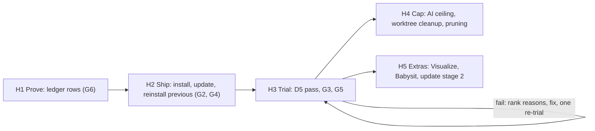

# PR Craft long-term roadmap: from built to used by a team

- **Author:** artid.jirayu
- **Status:** Approved, 2026-11-28 (two review rounds; reports kept outside the repository)
- **Date:** 2026-11-28

## Overview

PR Craft has milestones M0 to M9 built, but its core loop has never posted to a real forge and no one but the author has run it. This roadmap is for the maintainer and for a team of 3 to 8 engineers who each want to clear their daily GitHub and GitLab review queue without the forge web UI. It orders the work in five horizons (prove, ship, trial, cap, extras); H1 to H4 each close on one observable exit line, and each H5 item closes on its own. Diagnostics, additive-only data formats and the quota safety guard land before the first hand-out. All work stays in this repository and the user's own GitHub account, with no request to storytold.

Context for readers new to the repo. **storytold** is the GitHub organisation that publishes the Craft house rules (`AGENTS.md`, rules 1 to 37, synced from `storytold/craft-contrib`) and the libraries this app builds on: `craft-libs` (the `craft` facade crate, pinned to one rev in `Cargo.toml`), and forks of `egui`, `winit`, `vectorcraft` and `winprint.rs`. "Rule N" below means rule N of `AGENTS.md`; rules marked SHOULD may be departed from with a reason stated in the PR (`AGENTS.md`, preamble). App terms: the **inbox** lists changes waiting on the user; **Back to you** lists changes the user reviewed that came back with new activity; **Your changes** lists the user's own changes; the **bounded runner** (`crates/forge/src/bounded.rs`) runs every subprocess with an output cap and a deadline; `post_unknown` is a flag on a local review set when a post to the forge timed out, so the app cannot know whether it landed, and the next submit refuses until the user confirms.

## Decisions

| Id | Decision | Options considered | Choice | Reason |
| --- | --- | --- | --- | --- |
| D1 | Visualize format | AI HTML in a webview; .html opened in the browser; template JSON or SVG drawn natively; cut | Template JSON or SVG drawn with egui and the existing SVG renderer and caps | The user chose it; it keeps rule 11 (SHOULD, no webview) without a departure and keeps links into the diff; the SVG path exists (crates/core/src/svg.rs) |
| D2 | Babysit write path | Write tools in the AI engine; auto-push with a rollback ref; AI patch applied by the app, pushed by the user; cut | AI returns a patch against the exact head SHA; the app applies it locally; the user pushes with one explicit action | Keeps M6's no-tools engine; a rollback ref cannot undo fetched commits, CI runs or mail; PRODUCT principle 4 |
| D3 | storytold-pinned dependencies | Keep the pins; mirror into the user's account | Mirror all five storytold sources in Cargo.lock (craft-libs, egui, winit, vectorcraft, winprint.rs) with `git push --mirror`; repoint with `[patch]` entries; rule-10 SHOULD departure stated in that PR | User excluded storytold; identical SHAs keep every pinned rev, including `craft::egui_fork::REV`, true |
| D4 | Update path | Manual download only; full self-update now; staged | Stage 1: version check and download from `craft::update`'s `GitHubSource` and `sha256_file`, plus written apply steps. Stage 2 (self-replace) gets its own design | `GitHubSource` reads the Release and `SHA256SUMS.txt` and falls back to release pages when the API is out of quota (source.rs:3-6); the rest of `craft::update` assumes the Craft App Suite catalog and a signed DMG (app.rs:80-83, install.rs), so it is not used |
| D5 | Success measure | Telemetry; user's feeling; self-report tally | 5-day tally per member: items cleared, forced forge opens with origin and reason, app version. Origins come from the app's own "Open on forge" log | No usage data leaves the Mac; the reasons become the ordered backlog |
| D6 | Meaning of "team" | Shared accounts and settings; independent installs | N independent installs of a single-user app; only the Release channel is shared; members are chosen before H2 exits | Team features are a non-goal; H2's second Mac is the first member |
| D7 | Data safety across versions | Per-file `v` with read-only refusal and backups; additive-only formats | Additive-only: fields are only added, optional with defaults; unknown keys are kept through a round trip; no `deny_unknown_fields` on persisted types; one `data-version` file stamps the format for diagnostics | Every build reads and writes every file, so a downgrade stays postable (G4); a breaking change needs its own design |
| D8 | Notification delivery | craft-libs appkit binding; `osascript display notification` | `osascript` through the bounded runner, one banner per new unseen notification event; lands in H3 before trial day 1 | No `unsafe`, no storytold; missing banners would confound the trial |
| D9 | GitHub quota guard | None; fixed slower poll; measured budget with clamp and pause | Every poll-time GraphQL query reports `rateLimit`; the engine clamps the effective poll interval so the projected hourly cost stays at or under 1,250 points, pauses below 1,250 remaining until `resetAt`, and persists the last snapshot per Back to you candidate so only moved changes are read again. On-demand reads (threads.rs) stay outside the clamp | Your changes alone costs 57 points per poll (ROADMAP.md:121); Back to you can snapshot 300 changes per poll (turn.rs:47-86) |
| D10 | Mirror upkeep | Maintained (scheduled picks); frozen; frozen with an alarm | Frozen at the current revs; a weekly CI build on the newest macOS runner image is the alarm; `cargo xtask release` refuses while its latest run is not green, and a failure opens a pick PR on the mirror | Lowest cost; a breakage shows in CI before a member meets it |
| D11 | Horizon order | Features first; prove, ship, trial, cap, extras | Prove, ship, trial, cap, extras | Every later horizon depends on a core loop that has never run live (ROADMAP.md:150) |
| D12 | Error codes | String matching in the engine; typed causes from forge | `pr_craft_forge::FailKind` set at each failure site; `CommandError::Forge` carries it; `CommandError::code()` maps kinds to stable codes | Forge errors are strings today (engine/src/lib.rs:95-109); only the call site knows the cause |
| D13 | Release gate | All rows must pass; GitHub rows must pass, GitLab rows may be blocked | GitHub post, reply and resolve rows must pass; a GitLab row may be `blocked` with a reason, and then the Release notes and About say "GitLab writes not verified" | The dev Mac has no gitlab.com login (ROADMAP.md:74); one missing login must not stall every horizon |

## Goals and non-goals

**Goals**

- G1. Queue without the web UI (D5): in one shared window of 5 consecutive working days, a majority of the N members (at least 3) record 0 forced forge opens on 4 of 5 days; an unrecorded day counts as failed.
- G2. Self-serve install and update: a member installs from a GitHub Release and applies one update by following `docs/install.md` alone.
- G3. Triage from text: every failure a member reports during the trial is classified by its code (auth, scope, rate limit, network, CLI missing or old, timeout, refused by the forge, other forge failure, store read or write, crash) from a pasted `diagnostics.get` block alone.
- G4. No draft lost: an update, a reinstall of the previous Release, and a restart with an unsent batch each keep every local draft readable and postable.
- G5. Quota inside budget: during the trial, each member's polling uses at most 1,250 GraphQL points per hour (a quarter of 5,000), read from the projected points per hour that Sync shows.
- G6. Live-verified core: post, reply and resolve each pass once on a sandbox GitHub PR, and on a sandbox GitLab MR or are recorded `blocked` (D13), in `docs/live-ledger.md` before any Release is tagged.

**Non-goals**

- Windows and Linux builds.
- Team features: shared settings, shared drafts, dashboards, accounts.
- Pricing and licensing.
- Forges other than GitHub and GitLab.
- Apple Developer ID signing and notarization.
- Any request to storytold: no RFC, no craft-libs issue or pull request.
- Dock badge and menu-bar item (they need appkit bindings; the workspace forbids `unsafe`).
- Usage data leaving the Mac. The only network calls the roadmap adds are `update.check` and `update.download` to GitHub.
- Automatic pushes or posts by the AI engine (D2, PRODUCT principle 4).
- AI review in the trial: no live AI run is approved, so `docs/trial.md` excludes it.

## Problem

PR Craft is built but not usable by anyone except its author. No live write to a forge has run: ROADMAP.md:150 lists post, `thread.reply` and `thread.resolve` as never run, and the M2, M5, M6 and M7 status lines say "not run live" or "fixtures only" (ROADMAP.md:62, 96, 108, 121). A teammate cannot get the app: the repository builds only a bare 40 MB binary, with no .app bundle, no Release and no update path. If it fails on their Mac, nothing records why: no crate uses a logger, a Finder-launched app drops stderr (apps/pr-craft/src/main.rs:23), and every forge failure reaches the UI as `CommandError::Forge(String)` (crates/engine/src/lib.rs:95-109). An update can strand data: `load` leaves an unreadable file as it is (crates/engine/src/store.rs:197-203), and `Settings` and `Binding` reject unknown fields (crates/core/src/settings.rs:64, crates/core/src/keys.rs:125), so after a newer build adds one setting an older build stops loading settings. Daily use can exhaust the GitHub quota: Your changes costs 57 points per poll at 14 open changes (ROADMAP.md:121), which is 3,420 points per hour at the allowed 1-minute interval (crates/core/src/settings.rs:129); Back to you adds up to 300 snapshot queries per poll (crates/forge/src/turn.rs:47-86); and nothing reads the rate limit. The build and CI also depend on storytold: five git sources in Cargo.lock and two reusable workflows at `@main` (.github/workflows/ci.yml:22, house-rules.yml:26).

## Proposed design

### Shape: five horizons with exit gates

Work ships as one PR per numbered Order step; human gates (live runs, member setup, the trial) are separate lines. H1 to H4 close on their exit line; each H5 item closes on its own.

### Trial loop and human gates (D5, D6)

- Members (N, Macs, macOS versions, a shared 5-day window) are chosen before H2 exits; the H2 second Mac is the first member.
- A failed trial ranks reasons by count; fixes land; members get one updated zip; one re-trial runs with the same members. A second failure stops the loop and reopens D5 and G1 with the user.
- H4 may start while H3 iterates; it uses no trial output.

### Diagnostics (D7, D12, H1)

- Log: `crates/engine/src/log.rs` appends one line per engine command to `~/Library/Logs/PR Craft/pr-craft.log`: time, command id, forge, host, repository, outcome, duration, code. No tokens, diff bodies or comment text. Rotates at 5 MB, keeping one old file.
- Codes (D12): `FailKind` = `Auth`, `Scope`, `RateLimit`, `Network`, `CliMissing`, `CliOld`, `Timeout`, `Refused`, `Other`, set where forge classifies a CLI failure (exit status, stderr markers). `CommandError::Store` carries a `Read` or `Write` kind set where the store fails. Codes: `E-FORGE-<KIND>`, `E-STORE-READ`, `E-STORE-WRITE`, `E-PARAMS`, `E-INVALID`, `E-UNKNOWN`, `E-ENCODE`, `E-PANIC`. The UI shows the code beside the message.
- `diagnostics.get`: version (`env!("CARGO_PKG_VERSION")`), commit (`option_env!("PR_CRAFT_COMMIT")`, set by `xtask bundle`, else `dev`), macOS, `gh`/`glab`/AI-engine versions and paths, `forge.status` per host, last good sync per host, the `data-version` stamp, and the last 200 log lines passed through `pr_craft_core::redact` with the home path replaced by `~`. CLI `pr-craft-cli diagnostics.get`; app Copy button on Settings → Offline and sync.
- Panic hook in both binaries writes the panic and backtrace to the log as `E-PANIC`.

### Additive-only data (D7, H1)

- Persisted structs drop `deny_unknown_fields` and keep unknown keys in a `#[serde(flatten)] extra` map; new fields are `Option` or `#[serde(default)]`. Covered: `Settings`, `Binding`, `LocalReview`, `EngineSettings`, `Agent`, `LayoutOptions`, `Run`, `NotifyState`, `Pause`.
- Persisted enums (`FileView`, `Verdict`) gain a `#[serde(other)]` fallback variant: an unknown `FileView` reads as the default view for its extension; an unknown `Verdict` reads as no verdict chosen, and the composer says "Verdict set by a newer version; choose again".
- `Settings::patched` refuses keys that `Settings` does not name, so `settings.set` still catches typos (today that guard comes from `deny_unknown_fields`, settings.rs:159-163).
- `data-version` (one file in the data dir) holds the format number, 1; `diagnostics.get` reports it. Raising it needs its own design.
- Pruning (H4) never removes a review file that holds drafts or `post_unknown`.

### Forge robustness (D9, H1 to H3)

- One tool resolver in core (moved from `find_tool`, engine/src/local.rs:723-726, with Homebrew fallbacks like `Editor::fallbacks`) builds every `gh`, `glab`, `git` and AI-engine command, so a Finder launch finds them.
- Version probe for `gh`, `glab` and the AI engine at start; below the tested minimum, the login banner (crates/ui-egui/src/lib.rs:505) shows the version and the `brew upgrade` command. `Login::Scope` joins the existing `CliMissing` and `LoggedOut`.
- Quota safety (H2, before hand-out): every poll-time GraphQL query asks `rateLimit { cost remaining resetAt }`; the engine clamps the effective interval to keep projected cost at or under 1,250 points per hour, pauses below 1,250 remaining until `resetAt`, and Sync shows the effective interval, the projected points per hour and any pause.
- Quota cost (H3): `snapshots.json` persists, per Back to you candidate, its `updatedAt` and its last snapshot. Unmoved candidates reuse the stored snapshot, including on the first poll after launch, so they keep their row and reasons. GitLab reads one `merge_requests` list per host per poll for all three queues and waits on 429 `Retry-After`.

### Live-verified ledger (D13, G6, H1)

`docs/live-ledger.md` has one row per command and forge: command, forge, host, milestone, sandbox change, date, result (`pass`, `fail`, `blocked: <reason>`), how run. Rows: `review.submit` (post), `thread.reply`, `thread.resolve`, `draft.add` on a rendered view, `review.hand_off`. `cargo xtask release` refuses unless the three GitHub rows for post, reply and resolve are `pass`, no row is `fail`, and the latest weekly macOS build is green (`gh run list`, D10). Every live write needs the user's approval at the time it runs.

### Distribution and update (D4, H2)

- `cargo xtask bundle` builds for `aarch64-apple-darwin` (universal2 with `x86_64` when a member has an Intel Mac) with `PR_CRAFT_COMMIT` set to the HEAD commit, writes `PR Craft.app`, signs it ad hoc (`codesign --force --deep --sign -`), zips it, and writes `SHA256SUMS.txt`.
- `cargo xtask release` runs the ledger gate and the bundle and prints the `gh release create` command; the maintainer runs it after the user approves (rule 4).
- `update.check` uses `GitHubSource` on `jirayusueb/prcraft` (public, no token); `update.download` saves the zip to `~/Downloads`, verifies it with `sha256_file` against `SHA256SUMS.txt`, and the app reveals it in Finder.
- `docs/install.md`: first open on macOS Sequoia (System Settings → Privacy & Security → Open Anyway, `xattr -dr com.apple.quarantine` as fallback), and update (quit, unzip, replace in Applications, open). About shows version, commit, update state and Known limits (each accepted cut with its "Open on forge" key).

### Trial support (D5, H3)

- One ui-egui helper `open_on_forge(url, origin)` replaces the six direct `ctx.open_url` calls (lib.rs:428, 2034; checks.rs:361; panel.rs:1001; review.rs:2822, 2826) and calls `tally.bump` with the origin: screen, change, file type. Where an open is chosen as an act (review.rs:3977, 4006, 4206; threads.rs:161), the act carries the origin to the helper.
- `tally.json` keeps per day the bumps with origin and the app version; `tally.get` (app and CLI) prints a day with a suggested reason per bump. Members copy it into `docs/trial.md` and confirm or correct the reason.
- On reopening a change, the review shows "N drafts, M on changed lines" with a jump to each; Submit warns when a draft targets an outdated line.

### Notifications and caps (D8, H3 and H4)

- H3: `crates/engine/src/banner.rs` posts one banner per new unseen notification event (`ReviewRequested`, `BackToYou`, new commits; engine/src/turn.rs:277-340) with `osascript`, escaped text and a 5-second deadline. A non-zero exit shows "Banner not shown" with the reason. Settings → Notifications says banners come from Script Editor and have no buttons.
- H4: `ai.review.preview` returns an estimated token count (bytes ÷ 4); the confirm step shows it; AI settings hold a per-day token ceiling that `ai.review.start` enforces.
- H4: `checkout.remove` deletes a clean worktree (refuses a dirty one) and is offered when its change merges or closes. Pruning at start: review files of changes closed over 90 days ago (except drafts and `post_unknown`), run records beyond the newest 500, seen ids whose seen-at time (recorded from step 19 on; ids without one get the prune date) is over 180 days old.

### Dependencies and CI (D3, D10)

- Mirror the five storytold sources into the user's account with `git push --mirror`. Root `Cargo.toml` repoints `craft` and adds `[patch.crates-io]` and `[patch."<storytold url>"]` entries for every source, same revs.
- `cargo xtask ci` gains a `mirrors` check: Cargo.lock names no `github.com/storytold/` source. `craft::egui_fork::check_lockfile` is not used; its `GIT` constant names storytold.
- CI: an H1 PR pins both reusable workflows to a commit SHA. An H2 PR replaces them with in-repo jobs (`cargo xtask ci`, parity renders on macOS, a weekly read-only forge-parser run against the newest `gh` and `glab`, a weekly release build on the newest macOS image). It states the rule-17 SHOULD departure.

### After the measure (H5)

Each gets its own design doc and exit line before code. Visualize (D1): the AI returns template JSON or SVG under the existing caps; ui-egui draws it; links resolve to diff lines. Trigger: a recurring tally reason "opened the forge to understand the change". Babysit (D2): the AI returns a unified diff against the head SHA; the app applies it in a worktree and shows it as a review; one explicit push sends it; iteration and spend caps are entry requirements. Trigger: the user's own author-side forced opens, recorded in the same tally. Update stage 2 (self-replace, previous .app kept). Trigger: trial tallies show members on an older version than the latest Release.

## Alternatives considered

### Features first, verification later

- **What it does:** continue M7 Babysit, Visualize and more file views, and verify live at the end.
- **Why it lost:** every later feature stacks on a write path that has never run (ROADMAP.md:150); the team would find the bugs.

### Telemetry for the success measure

- **What it does:** count forge web visits or app use automatically.
- **Why it lost:** usage data must not leave the Mac; the tally also captures the reason, which telemetry cannot.

### Visualize as AI HTML (webview or browser)

- **What it does:** render AI-made HTML in a sandboxed webview, or open the .html in the default browser.
- **Why it lost:** the user chose native drawing (D1); the webview departs from rule 11, and the browser variant loses the links into the diff.

### Babysit with write tools or automatic pushes

- **What it does:** give the AI engine git and push tools, or auto-push to the PR's own branch with a rollback ref.
- **Why it lost:** it reverses M6's no-tools engine; a rollback ref cannot recall fetched commits, CI runs or mail; it breaks PRODUCT principle 4.

### Per-file versions with read-only refusal

- **What it does:** a `v` in every file; an older build opens a newer file read-only and refuses to save it.
- **Why it lost:** submit writes the review file (crates/engine/src/review.rs:260-313), so a downgraded build could not post, breaking G4; map-shaped files would need wrapper schemas.

### Native notifications through a craft-libs binding

- **What it does:** post banners and the Dock badge through appkit bindings in craft-libs.
- **Why it lost:** it needs `unsafe` and a storytold change, both excluded; `osascript` needs neither.

### Full `craft::update`, a hand-written updater, or `gh release download`

- **What it does:** use the whole Craft updater, write download and checksum code, or shell out to `gh`.
- **Why it lost:** the full updater expects the Craft App Suite catalog and a signed DMG; `GitHubSource` and `sha256_file` already cover stage 1; `gh` is not needed for a public repo.

### Keep the storytold pins

- **What it does:** keep `Cargo.toml` and the workflows on storytold.
- **Why it lost:** the user excluded storytold.

### Do nothing

- **What it does:** keep M0 to M9 as built and use the app alone.
- **Why it lost:** the team cannot install it and no write is proven.

## Risks and mitigations

| Risk | Severity | Mitigation |
| --- | --- | --- |
| A live write misbehaves on a real change (double post, wrong line) | Major | Sandbox changes only; the user approves each run; `post_unknown` refusal stays; the ledger records each result |
| No gitlab.com login, so GitLab rows never pass | Major | D13: rows recorded `blocked`; Release and About say "GitLab writes not verified" |
| A macOS major breaks the frozen winit mirror | Major | D10 weekly build on the newest macOS image blocks the next release; a pick PR on the mirror; members reinstall the previous Release meanwhile |
| `GitHubSource` does not accept this repo's Release layout | Major | First H2 step is a spike against a test Release; fallback is reading `releases/latest` and `SHA256SUMS.txt` in the engine |
| Members stop at the Gatekeeper prompt | Major | `docs/install.md`; tested on a clean macOS user account before H2 exits |
| Reusable workflows at `@main` change under us | Major | H1 pin PR; H2 replaces them |
| Banner permission sits with Script Editor and is denied | Nit | "Banner not shown" with the fix; the in-app list is unaffected |
| The quota clamp lengthens the poll and a member sees a request late | Major | Sync shows the effective interval and pause; manual refresh stays possible within budget |
| An additive-only change is not actually additive | Blocker | Review rule in the PR template; a test per persisted type loads a file with an unknown key and saves it back unchanged |
| Members stop filling in the tally | Major | One line per day, pre-filled from `tally.get`; an unrecorded day fails, which the members know |
| `crates/ui-egui/src/review.rs` is 4,553 lines and H3 changes it | Major | A move-only split PR first, proven by parity renders |

## Detailed Implementation Plan

### Files

Each line starts with its Order step. (c) create, (m) modify, (mv) move.

- [1] `ROADMAP.md` (m) horizons section linking this design; Blocked: Visualize per D1, notifications per D8; fix ROADMAP.md:95 (the engine may use `craft` without UI features, xtask/src/layers.rs:41).
- [1] `PRODUCT.md` (m) Platform and Stack: macOS, Rust and egui; Visualize per D1; Babysit per D2.
- [1] `AGENTS.md` (m, `## This repository` only) Visualize line per D1.
- [2] `.github/workflows/ci.yml`, `.github/workflows/house-rules.yml` (m) pin `@main` to a commit SHA.
- [3] `crates/core/src/settings.rs`, `crates/core/src/keys.rs` (m) drop `deny_unknown_fields`; `extra` maps; `patched` refuses unknown keys.
- [3] `crates/core/src/review.rs`, `crates/core/src/agent.rs`, `crates/core/src/diff_view.rs`, `crates/core/src/run.rs` (m) `extra` maps on `LocalReview`, `EngineSettings`, `Agent`, `LayoutOptions`, `Run`; `Verdict` fallback variant.
- [3] `crates/core/src/view.rs` (m) `FileView` fallback variant.
- [3] `crates/engine/src/store.rs` (m) `extra` maps on `NotifyState` and `Pause`; write `data-version`; report unknown forge folders in `list_pending` instead of skipping them.
- [3] `crates/ui-egui/src/review.rs` (m) the composer line for a fallback `Verdict`.
- [4] `crates/forge/src/lib.rs` (m) `FailKind` and `ForgeError`; classify at `run`/`command` failure sites; `Login::Scope`.
- [4] `crates/engine/src/lib.rs` (m) `CommandError::Forge(ForgeError)`, `CommandError::Store` with a `Read`/`Write` kind, `code()`; `run` writes the log line; register `diagnostics.get`. `crates/engine/src/store.rs` (m) sets the store kind.
- [4] `crates/engine/src/log.rs`, `crates/engine/src/diagnostics.rs` (c) log and `diagnostics.get`.
- [4] `apps/pr-craft/src/main.rs`, `apps/pr-craft-cli/src/main.rs` (m) panic hook.
- [4] `crates/ui-egui/src/lib.rs`, `crates/ui-egui/src/settings.rs` (m) code beside messages; Copy diagnostics on Offline and sync.
- [5] `crates/core/src/tool.rs` (c) the resolver moved from `find_tool`; `crates/core/src/editor.rs` (m) uses it.
- [5] `crates/engine/src/local.rs`, `crates/engine/src/ai.rs`, `crates/forge/src/lib.rs` (m) build `git`, AI-engine, `gh`, `glab` commands through it; version probe.
- [5] `crates/ui-egui/src/lib.rs` (m) version and `brew upgrade` in the login banner; `Login::Scope` fix.
- [6] `docs/live-ledger.md` (c) the ledger, rows empty.
- [7] `Cargo.toml` (m) mirror URLs and `[patch]` entries; `xtask/src/main.rs` (m) `mirrors` check in `ci`.
- [8] `.github/workflows/ci.yml`, `.github/workflows/house-rules.yml` (m) in-repo jobs (see Dependencies and CI).
- [9] `crates/engine/src/update.rs` (c), `crates/engine/Cargo.toml` (m: add `craft`, workspace, `update` feature only), `crates/engine/src/lib.rs` (m) `update.check`, `update.download`.
- [10] `crates/forge/src/turn.rs`, `crates/forge/src/mine.rs`, `crates/forge/src/lib.rs` (m) `rateLimit` in every poll-time GraphQL query, returned with the result.
- [10] `crates/engine/src/mine.rs`, `crates/engine/src/turn.rs` (m) per-host budget, interval clamp, pause; `crates/ui-egui/src/lib.rs` (m) Sync shows effective interval, projected points per hour and pause.
- [11] `xtask/src/bundle.rs` (c), `xtask/src/main.rs` (m) `bundle` and `release`; `apps/pr-craft/macos/Info.plist` (c).
- [11] `crates/ui-egui/src/pages.rs` (m) About page; `docs/install.md` (c).
- [12] `crates/ui-egui/src/review.rs` (mv) to `crates/ui-egui/src/review/{mod,header,files,diff,composer}.rs`, no behaviour change.
- [13] `crates/engine/src/turn.rs`, `crates/engine/src/store.rs` (m) `snapshots.json` with `updatedAt` and last snapshot per candidate; `crates/forge/src/mine.rs`, `crates/forge/src/turn.rs` (m) one GitLab list read per poll; 429 `Retry-After`.
- [14] `crates/engine/src/tally.rs` (c), `crates/engine/src/lib.rs` (m) `tally.bump`, `tally.get`; `crates/ui-egui/src/lib.rs`, `crates/ui-egui/src/checks.rs`, `crates/ui-egui/src/panel.rs`, `crates/ui-egui/src/threads.rs`, `crates/ui-egui/src/review/*` (m) `open_on_forge`, the six calls and the act origins; `docs/trial.md` (c).
- [15] `crates/ui-egui/src/review/mod.rs` (m) drafts line on reopen; outdated-target warning on Submit.
- [16] `crates/engine/src/banner.rs` (c), `crates/engine/src/turn.rs` (m) banner per new event; `crates/ui-egui/src/settings.rs` (m) Notifications text.
- [17] `crates/engine/src/ai.rs`, `crates/core/src/agent.rs` (m) token estimate and ceiling; `crates/ui-egui/src/ai.rs` (m) estimate in the confirm step, ceiling field.
- [18] `crates/forge/src/checkout.rs`, `crates/engine/src/local.rs`, `crates/engine/src/lib.rs` (m) `checkout.remove`; `crates/ui-egui/src/mine.rs` (m) the offer on merge or close.
- [19] `crates/engine/src/store.rs` (m) pruning ages, the run cap, and a seen-at time per seen id (additive).

### Order

H1 Prove:
1. Docs PR (ROADMAP, PRODUCT, AGENTS "This repository"). No code changes.
2. CI pin PR. States the rule-17 SHOULD departure.
3. Additive-only data. Before merge, the author copies the data dir to `backup/pre-additive/` (builds before this step reject `extra` keys).
4. Typed forge errors, codes, log, panic hook, `diagnostics.get`.
5. Shared tool resolver and version probe.
6. Ledger file. Gate (user): approve each sandbox run; record results. **H1 exits** when the G6 rows pass or GitLab rows are `blocked`.

H2 Ship:
7. Mirror PR (rule-10 departure stated) with the `mirrors` check.
8. CI replacement PR (rule-17 departure stated).
9. Spike, then `update.check` and `update.download`.
10. Quota safety: `rateLimit`, clamp, pause, Sync readout.
11. `xtask bundle` and `release`, Info.plist, About, `docs/install.md`.
- Gate (user): choose members, Macs and the trial window; approve the first `gh release create`.
- Gate: clean-account install test by the maintainer. **H2 exits** when the second member installs, updates once and reinstalls the previous Release with drafts intact.

H3 Trial:
12. review.rs move-only split.
13. Quota cost: persisted baseline, GitLab list sharing, 429.
14. Tally and `open_on_forge`.
15. Drafts reconcile line and outdated warning.
16. Banners.
- Gate: the 5-day trial. **H3 exits** on the G1 pass line, with every reported failure classified (G3) and each member's guard readout at or under 1,250 points per hour (G5). On failure, the trial loop applies.

H4 Cap (may start during H3 iteration):
17. AI token estimate and ceiling.
18. `checkout.remove`.
19. Pruning. **H4 exits** when a member past the AI ceiling is refused with the reason, a merged change's worktree is offered for removal, and a pruned data dir still holds every draft.

H5: each item through its own design and review.

### Verification

- Every PR: `cargo xtask ci` (fmt, clippy `-D warnings`, tests, doctests, layers, renders compile; plus `mirrors` from step 7). When ui-egui changes: `cargo test -p pr-craft-ui-egui --features renders --lib parity::renders`.
- [3] Per persisted struct: load a file with an unknown key, save, assert the key survives; load a file with a field missing, assert the default. Per persisted enum: an unknown variant loads as the fallback. `settings.set` with an unknown key is refused.
- [3] G4 restart leg: write a review with two drafts, reload from disk in a new store, assert both drafts and `post_unknown` are intact.
- [4] Each `FailKind` from a fixture stderr maps to its `E-FORGE-*` code and that code appears in `diagnostics.get`; the output holds no home path and nothing `redact` would mask.
- [5] With `PATH` empty, the resolver finds a tool in a temp fallback dir.
- [10] A fixture `rateLimit` with high cost lengthens the effective interval; one below 1,250 remaining skips polls until `resetAt`.
- [13] A fresh store with a persisted baseline snapshots only candidates whose `updatedAt` moved, and an unmoved candidate still appears in Back to you with its reasons.
- [14] `tally.bump` then `tally.get` returns the bump with its origin and version.
- [16] A fake runner exiting non-zero yields "Banner not shown".
- [11] `codesign --verify` passes; `shasum -a 256 -c SHA256SUMS.txt` passes.
- [19] Pruning a dir with an old closed review that holds a draft keeps that file.
- Live rows and the H2 and H3 gates are run by hand and recorded in the ledger and `docs/trial.md`.

### Rollout and rollback

- Each numbered step is one PR; a revert restores the previous behaviour.
- Step 3 changes on-disk shape for builds before it: a pre-step-3 build rejects files with `extra` keys. Before H2 no one else runs the app; the author restores from `backup/pre-additive/`. From step 3 on, every build reads every file (D7).
- Releases stay on GitHub; a member reinstalls the previous one by following `docs/install.md`.
- The mirror PR reverts by pointing `Cargo.toml` back to the storytold URLs (same SHAs).

## Open questions

- Which account hosts the mirrors (the user's account or a new org)? Owner: the user, before step 7.
- Which GitHub repo and gitlab.com project serve as sandboxes, and whether a gitlab.com login will exist. Owner: the user, before step 6.
- Tested minimum versions for `gh`, `glab` and `claude` (fixtures are on gh 2.89 and glab 1.99). Owner: the maintainer, in step 5.
- N, members, their Macs and the trial window. Owner: the user, before H2 exits.
